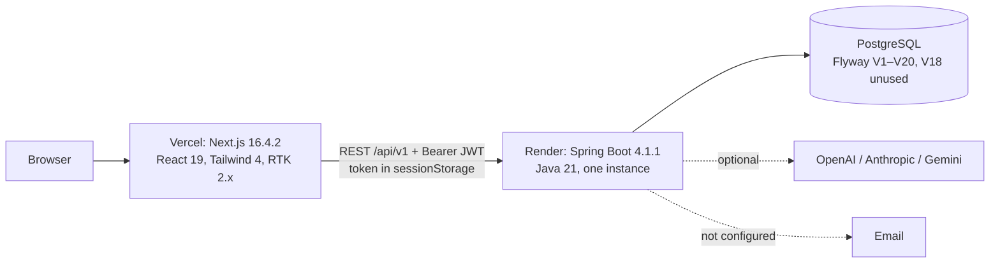

# GrowthPrint MVP1 Technical Audit

**Date:** 3 November 2026 · **Type:** audit only (no source, schema, config or infrastructure changes)
**Repositories inspected (local working copies):**

| Repo | Branch at audit time | Working tree |
|---|---|---|
| `growthprint-backend` | `feature/growthprint-professional-improvements` | 21 changed/untracked paths (uncommitted account-security work + docs) |
| `GrowthPrint-frontend` | `feature/premium-ui-modernization` | 58 changed/untracked paths (uncommitted recovery/settings/UI work) |

Labels used: **[V]** verified in code or by running a command · **[I]** inferred · **[R]** recommendation · **[?]** open question.
Not inspected: live Render/Vercel dashboards, the production database, GitHub Actions run history.

> Companion document: the MVP2 design proposal (published as a private artifact, "GrowthPrint MVP2 Design")
> expands sections 10–13 with diagrams, ADRs and research sources. This audit is the evidence base for it.

---

## 1. Executive summary and MVP1 readiness

MVP1 is a **well-structured, single-tenant agency back office** for GrowthPrint itself: leads, CRM, clients,
projects, support requests with estimates, proposals, invoices (with PDFs and client payment reports),
outreach drafts with human approval, a client portal, staff with module permissions, and an admin-configured
AI provider layer. Security engineering is above average for an MVP (per-request account checks with token
revocation, an HTTP role-matrix test over every route, RFC 9457-compatible errors, rate limits, audit log).

**Readiness verdict**

| Use | Readiness |
|---|---|
| Operating GrowthPrint's own agency (one tenant) | **Good**, once the uncommitted work is committed and CI is fixed |
| Foundation for a multi-tenant MVP2 platform | **Not ready** — no tenant model, no background processing, agency-specific domain |

**Critical risks**

1. **No tenant isolation at all** [V]: none of the 23 tables has a workspace/tenant key. MVP2 cannot onboard a
   second business safely until this exists.
2. **Backend CI is broken or ineffective** [V by reading; not executed on GitHub]: `ci.yml` runs `./mvnw.cmd` on
   `ubuntu-latest` and disables the integration step with `if: false`.
3. **Database tests do not run anywhere automatically** [V]: 40 PostgreSQL tests skip without
   `GP_IT_DATABASE_URL`, including the new account-security workflow test.
4. **No asynchronous processing** [V]: no scheduler, queue or worker; every MVP2 integration, automation and
   reminder depends on one.
5. **Large uncommitted change sets in both repos** [V]: a lost working copy would lose the account-security,
   recovery, settings and UI work.
6. **"Send" features do not send** [V]: `OutreachDraftService.send` only sets status `SENT`; no email provider
   exists (`UnconfiguredAccountEmailSender`).

---

## 2. Module inventory and implementation status

### Backend (`src/main/java/com/growthprint/backend`)

| Module (package) | Status | Evidence / notes |
|---|---|---|
| `auth` (login, me, account, recovery, invitations) | Implemented | `AuthController`, `AccountController`, `AccountRecoveryController`; V5, V17, V20 |
| `security` (JWT, per-request session check, audit) | Implemented | `JwtAuthenticationFilter`, `AccountSessionService`, `SecurityAudit` |
| `useradmin` (users, staff, permissions) | Implemented | `AdminUserController`; ADMIN-only |
| `inquiry` + `lead` (public inquiry → raw lead) | Implemented | `POST /public/inquiries`, rate limited |
| `crm/lead` (pipeline) | Implemented | Convert inquiry → CRM lead; **no convert-to-client endpoint** (expected by an untracked test) |
| `client` | Partial | List, get, PATCH; **no create, no delete** |
| `project` (+ milestones) | Implemented (basic) | No tasks module |
| `support` (requests, classification, estimates) | Implemented | Client `/my` endpoints with ownership checks |
| `proposal` | Implemented | Publish, client decision |
| `invoice` (+ PDF, payment reports) | Implemented | OpenPDF; admin verification marks PAID |
| `outreach` | Partial | Drafts, approve, "send" = status change only |
| `ai` (settings, adapters, triage, usage) | Implemented, global | OpenAI-compatible, Anthropic, Gemini adapters; AES-GCM key (`AI_CREDENTIALS_ENCRYPTION_KEY`) |
| `seed` | Dev-only | `@Profile("seed")` / `@Profile({"dev","development"})`; seed password in repo (see §6) |
| Notifications, activity stream, approvals (generic), automation, integrations, workspaces | **Absent** | — |

### Frontend

| Area | Status | Evidence |
|---|---|---|
| Public site + inquiry modal | Implemented | `features/public/*` |
| Auth: login, forgot/reset password, accept invite | Implemented (uncommitted) | `features/auth/components/*`, `app/(public)/*` |
| Studio (admin/staff) at `/studio/ops` | Implemented; tab-based single page | `app/(admin)/studio/ops/page.tsx`, `features/admin/*` |
| Client hub at `/client-hub` | Implemented | `features/portal/*` |
| Account settings, users & team | Implemented (uncommitted) | `features/settings/components/*` |
| Automation view | **Cosmetic only** | `AdminAutomationView.tsx` shows "n8n Architecture Ready" with no engine behind it |
| Messages view (portal) | Inferred demo-only [I] | `PortalMessagesView.tsx`; no messages API exists in the backend |
| Mock mode | Opt-in (`NEXT_PUBLIC_USE_MOCK_API=true`) | `lib/api/client.ts`, `features/agency/initialData.ts` |

---

## 3. Architecture diagrams

### As-built deployment



### Backend layering

```mermaid
flowchart TB
  F[Filters: RateLimit → Correlation → JWT + AccountSessionService] --> C[Controllers<br/>@PreAuthorize per method]
  C --> S[Services @Transactional]
  S --> Rp[Spring Data JPA repositories]
  Rp --> DB[(PostgreSQL)]
  C -. errors .-> GEH[GlobalExceptionHandler → ApiErrorResponse RFC 9457]
```

### Frontend structure

```mermaid
flowchart TB
  App[app/ routes: (public) · (admin)/studio/ops · (portal)/client-hub] --> Guard[WorkspaceGuard]
  Guard --> Feat[features/admin · portal · settings · auth · public]
  Feat --> Store[Redux store: auth, agency (2,324-line slice), ui]
  Feat --> UI[components/ui (forms.tsx kit, DataTable, Badges…)]
  Store --> API[lib/api/client.ts fetch wrapper (retries GET only, 401 handler)]
  Proxy[proxy.ts: /portal→/client-hub 308, /admin 404, noindex] -.edge.-> App
```

---

## 4. API endpoint inventory and contract assessment

86 HTTP mappings were extracted from `@RestController` classes [V] (grep of `@*Mapping`). Grouped:

| Group | Endpoints | Access |
|---|---|---|
| Public | `POST /public/inquiries`, `POST /auth/login`, `POST /auth/logout`, `GET /auth/password/policy`, `POST /auth/password/{forgot,reset,reset/verify}`, `POST /auth/invitations/{preview,accept}` | Anonymous, rate limited |
| Self | `GET /auth/me`, `POST /auth/password`, `GET/PATCH /account/profile`, `POST /account/password`, `POST /account/sessions/revoke` | Any authenticated |
| Leads/CRM | `GET /leads`, `GET/POST /crm-leads`, `GET/DELETE /crm-leads/{id}`, `PUT /crm-leads/{id}/pipeline-stage`, `POST /crm-leads/inquiry/{id}/convert` | ADMIN or PERM_CRM |
| Clients | `GET /clients`, `GET/PATCH /clients/{id}` | ADMIN or PERM_CLIENTS |
| Projects | `GET/POST /projects`, `GET /projects/{id}`, `PATCH /projects/{id}/status`, `POST /projects/{id}/milestones`; `GET /projects/my` | ADMIN/PERM_PROJECTS; CLIENT for `/my` |
| Support | list/get/create/classify/estimate/approve-estimate/status; `/my` list, create, approve-estimate; `POST /{id}/ai/triage` | ADMIN/PERM_SUPPORT; CLIENT `/my`; triage ADMIN |
| Proposals | list/get/create/update/publish; `/my` list + decision | ADMIN/PERM_PROPOSALS; CLIENT `/my` |
| Invoices | list/get/create/reconcile/pdf, payment-report verify/reject; `/my` list, pdf, report payment | ADMIN; CLIENT `/my` |
| Outreach | list/get/approve/send drafts | ADMIN or PERM_OUTREACH |
| Admin | `/admin/ai/**` (7), `/admin/users/**` (10), `/admin/security/overview` | ADMIN |
| Dev | `POST /dev/seed` | ADMIN + dev profile |

**Contract assessment**

- [V] Consistent `/api/v1` versioning, DTO records (no entities exposed), Bean Validation on bodies,
  RFC 9457-compatible error body (`type,title,status,detail,instance` + legacy `message,fieldErrors`).
- [V] Every route is covered by `RoleMatrixSecurityTest` (anonymous / CLIENT / ADMIN / TEAM_MEMBER).
- [V] Unknown routes are denied (`anyRequest().denyAll()`).
- [V] **No pagination** on any list endpoint — lists return full collections.
- [V] **No idempotency keys** on create/trigger endpoints.
- [V] Gaps relative to the frontend's expectations: no `POST /clients`, no `DELETE /clients/{id}`, no
  `POST /crm-leads/{id}/convert-to-client` (all expected by the untracked
  `PortalOnboardingWorkflowIntegrationTest`).
- [I] `PATCH` uses `@RequestMapping(method = PATCH)` in `ProjectController` — works, inconsistent style.
- [V] OpenAPI via Springdoc; production toggle `SPRINGDOC_ENABLED` exists.

---

## 5. Database schema and relationship assessment

Migrations V1–V20 (V18 intentionally unused) [V]. Tables: `leads`, `clients`, `crm_leads`, `users`,
`projects`, `project_milestones`, `invoices`, `invoice_line_items`, `outreach_drafts`, `support_requests`,
`support_estimates`, `proposals`, `invoice_payment_reports`, `user_invitations`, `client_assignments`,
`team_member_permissions`, `ai_settings`, `ai_usage`, `password_reset_tokens` (+ duplicates across V1/V11 for
`clients`, `crm_leads`, `projects`, `project_milestones` created with `IF NOT EXISTS`).

| Topic | Assessment |
|---|---|
| Keys / FKs | UUID PKs; FKs from projects/invoices/support/proposals to `clients`; users → clients (`ON DELETE SET NULL`) [V] |
| Constraints | CHECK constraints for enums; V14 trigger for invoice line-item integrity; unique estimate per request (V16) [V] |
| Deferred validation | V17 adds `chk_users_client_membership` and `chk_users_password_set` as **`NOT VALID`** — historic rows are not checked [V] |
| Duplicate DDL | `CREATE TABLE IF NOT EXISTS` for the same tables in V1 and V11 [V] — schema depends on which ran first; **risk of drift between environments** [I] |
| Indexes | Present on FKs and status columns for most tables [V]; no composite (tenant, …) indexes because there is no tenant |
| Tenant readiness | **None** — no `workspace_id`/`tenant_id` anywhere [V] |
| Hibernate | `ddl-auto: validate`, `open-in-view: false` [V] — good |
| Retention | No retention or purge jobs (except expired reset tokens cleaned opportunistically) [V] |

**Migration risks for MVP2:** backfilling `workspace_id` into every table of live data; `NOT VALID`
constraints may hide existing bad rows (run `ALTER TABLE … VALIDATE CONSTRAINT` in a rehearsal first);
the V1/V11 duplication must be reconciled before adding composite FKs. **[R]** Rehearse on a production copy.

---

## 6. Security and multi-tenancy assessment

| Control | Status |
|---|---|
| Authentication | JWT HS256, issuer check, secret ≥ 32 chars and not the leaked default, 1 h expiry [V] |
| Session revocation | `token_version` + per-request account check (status, role, version) [V] |
| RBAC | ADMIN / TEAM_MEMBER (module permissions loaded per request) / CLIENT; URL rules + `@PreAuthorize` [V] |
| Ownership | Client `/my` endpoints check client ownership (404 or 403) [V] |
| Staff scoping | `client_assignments` **not enforced** — staff with a module see all its records [V] |
| Passwords | BCrypt; policy for new passwords; reset tokens hashed, single use, 30 min [V] |
| Rate limits | In-memory, per instance: inquiries, login (per IP + per account), recovery [V] |
| CORS | Explicit origins from `CORS_ALLOWED_ORIGINS`; `*` rejected [V] |
| Headers | CSP on `/api/**`, X-Frame-Options DENY, Referrer-Policy no-referrer, Permissions-Policy [V] |
| Secrets | From environment; `.env` git-ignored [V]. A `.dev-credentials` file exists in the backend working copy [V] — **[?] confirm it is ignored and contains no live credentials** (not opened in this audit) |
| Seed account | `SeedDataCommand` contains a known password (profile `seed` only) [V] — **[?] verify no such account exists in production** |
| Token storage (frontend) | `sessionStorage` — readable by scripts on an XSS bug [V] |
| CSRF | Not applicable while auth is a Bearer header [V]; becomes required if cookies are introduced |
| Multi-tenancy | **Not present.** Any MVP2 tenant would see all data [V] |
| Audit | `SECURITY_AUDIT` logger for account events [V]; no business-activity audit trail |

---

## 7. Technical debt, defects and risks (by severity)

| Sev | ID | Finding | Evidence | Recommendation |
|---|---|---|---|---|
| Critical | D1 | No tenant model | migrations V1–V20 | Workspace model + backfill before any MVP2 module |
| Critical | D2 | Backend CI runs a Windows script on Linux; integration step disabled | `.github/workflows/ci.yml` | Use `./mvnw`, add a PostgreSQL service, run postgres-tagged tests |
| Critical | D3 | Uncommitted work in both repos | `git status` | Review and commit on the feature branches |
| High | D4 | DB-dependent tests (40) never run automatically | surefire output | CI database + fail on skip for tagged tests |
| High | D5 | No background processing | no `@Scheduled`/`@Async`/queue | Outbox + job table + worker |
| High | D6 | Outreach "send" and email notifications do not deliver | `OutreachDraftService.send`, `UnconfiguredAccountEmailSender` | Choose an email provider; label UI honestly until then |
| High | D7 | Untracked test expects missing endpoints | `PortalOnboardingWorkflowIntegrationTest` | Implement or remove those expectations (decision) |
| High | D8 | Duplicate `CREATE TABLE IF NOT EXISTS` across V1/V11 | migrations | Verify production schema equals a fresh migrate (schema diff) |
| Medium | D9 | No pagination on lists | controllers | Cursor pagination before data grows |
| Medium | D10 | `client_assignments` not enforced | `SECURITY.md` | Replace with workspace-level resource checks |
| Medium | D11 | In-memory rate limiter | `InMemoryRateLimiter` | DB-backed or shared store before scaling out |
| Medium | D12 | JWT in `sessionStorage` | `authSlice.ts` | httpOnly cookie + refresh token (needs same-site domains) |
| Medium | D13 | 2,324-line Redux slice mixing server cache and UI | `features/agency/agencySlice.ts` | RTK Query per feature |
| Medium | D14 | `NOT VALID` constraints hide historic violations | V17 | Validate in rehearsal |
| Low | D15 | Cosmetic "n8n Architecture Ready" automation view | `AdminAutomationView.tsx` | Replace with real Automation Centre |
| Low | D16 | Frontend "lint" is only `tsc`; no ESLint | `package.json` | Add ESLint (new dev dependency, needs approval) |
| Low | D17 | Studio is one client page switching tabs (no deep links per module) | `studio/ops/page.tsx` | Route per module in MVP2 shell |
| Low | D18 | CI label says JDK 17 while installing 21 | `ci.yml` | Fix with D2 |

---

## 8. Functionality MVP2 must preserve

- Public inquiry → raw lead → CRM lead pipeline.
- Client lifecycle with projects/milestones, support requests with estimate approval by the client, proposals
  with client decision, invoices with PDFs and client payment reporting + admin verification.
- Client hub (`/client-hub`) for existing client users; legacy `/portal` redirect.
- Account security: login throttles, password policy, reset, invitations, sign-out-everywhere, token revocation.
- Staff (TEAM_MEMBER) module permissions; admin user management guard rails (no self-demotion, last admin).
- AI provider settings with encrypted keys and per-user daily limits; AI support triage.
- RFC 9457 error format and the role-matrix test as a regression safety net.

---

## 9. MVP1 → MVP2 capability gap analysis

| MVP2 module | Exists today | Gap |
|---|---|---|
| Business Blueprint / onboarding | None | New: profile, conditional questionnaire, recommendations, apply-with-confirmation |
| Workspace & Command Centre | Studio dashboard (agency-specific) | Workspaces, memberships, switcher, module toggles, terminology, action-oriented home |
| Clients / projects / tasks / team | Clients, projects, milestones, staff | Universal customers + typed records, **tasks module**, assignment, per-workspace roles |
| AI Assistant + Gateway | Global provider layer + triage | Workspace scoping, capabilities, prompt versions, structured output, budgets, conversations, tools |
| Automation Centre | None (cosmetic view) | Engine, templates, runs, retries, scheduling |
| Integration Centre | None | OAuth framework, token vault, Google Calendar/Gmail adapters, sync, webhooks |
| Approval Centre | Outreach approve only | Generic approval requests with payload hash and execution |
| Notification Centre | Frontend demo dropdown [I] | Backend notifications, preferences, email channel |
| Activity & Execution History | Security audit log only | Activity stream, run/step history |

---

## 10. Recommended MVP2 target architecture and module boundaries [R]

- **Modular monolith** (Spring Boot) + a **worker process** from the same image (`profile=worker`).
- Modules: Identity & Access · Tenancy & Workspace · Business Core (customers, records, tasks, documents) ·
  Activity & Audit · Outbox & Jobs · Approvals · Notifications · Integrations (adapters behind ports) ·
  AI Gateway (extend existing `ai` package) · Automation (native engine, templates in code) · Entitlements.
- Cross-module reads via interfaces; side effects via a transactional outbox consumed by the worker.
- Existing agency modules continue as an "agency pack" scoped to the GrowthPrint workspace.
- n8n only for GrowthPrint's internal use, if at all (licence restricts customer-credential use without an
  Embed agreement); Temporal deferred (operational cost).

## 11. Database and API evolution strategy [R]

1. **Expand:** create `workspaces`, `workspace_memberships`; insert the GrowthPrint workspace; add nullable
   `workspace_id` to every business table; backfill.
2. **Contract:** set `NOT NULL`, add composite FKs `(workspace_id, id)`, composite indexes; validate `NOT VALID`
   constraints; reconcile V1/V11 duplicates first.
3. **Defence in depth:** PostgreSQL RLS on sensitive tables (credentials, external events, AI messages, documents).
4. **API:** new tenant routes `/api/v1/workspaces/{workspaceId}/…`; existing routes stay, mapped to the
   GrowthPrint workspace, until clients migrate; add cursor pagination and `Idempotency-Key`; keep RFC 9457.
5. Every migration rehearsed on a copy of production; forward-only Flyway (next version **V21**).

## 12. Dependency-aware roadmap [R]

| Milestone | Depends on | Acceptance criteria |
|---|---|---|
| M0 Baseline: commit WIP, fix CI, DB tests in CI, schema diff vs production | — | CI green, 0 skipped DB tests, schema diff clean |
| M1 Tenancy & identity | M0 | Tenant-isolation matrix passes; MVP1 flows work inside the GrowthPrint workspace |
| M2 Platform: outbox, jobs, worker, activity, notifications, approvals core, entitlements | M1 | Crash-recovery + idempotency tests; worker deployed |
| M3 Business core + Blueprint (tasks, typed records, terminology, onboarding) | M2 | New solo workspace configured in < 10 min |
| M4 Integration foundation + Google Calendar | M2 | Sync, 410 resync, watch renewal, revoke tested against fakes |
| M5 AI Gateway + Assistant (read-only tools) | M2, M3 | Budgets enforced; eval set passes; no cross-tenant context |
| M6 Automation Centre (templates without email first) | M2, M3, M5 | Each template has failure/retry tests |
| M7 Email channel (Gmail after Google verification, or forwarding inbox) | M4, M6 | No-double-send tests; approval before send |
| M8 Command Centre & UI shell (parallel from M3) | M3 | Core screens WCAG 2.2 AA, p95 < 400 ms |
| M9 Pilot readiness | all | Restore drill, runbooks, export/delete, 3–5 pilot workspaces |

Rough effort: 30–41 weeks for one developer; ~20–26 with two (estimates, not commitments).

## 13. Testing and production-readiness strategy [R]

- **PR gate:** backend compile + unit + PostgreSQL integration (Testcontainers or `GP_IT_DATABASE_URL`),
  role/tenant matrix, frontend `tsc`, unit tests, OpenAPI diff.
- **Tenant isolation matrix:** every tenant endpoint × {anonymous, other-workspace member, Member, Admin, Owner};
  foreign ids must return 404 and change nothing.
- **Async:** fake-clock tests for retries, lease expiry (worker crash), idempotent re-execution, approval pause.
- **Provider fakes:** reuse the `FakeProviderServer` pattern for Google and LLM failures (429, 410, timeouts).
- **E2E:** extend the Playwright suite (11 stubbed journeys exist) with seeded-backend journeys in CI.
- **Release gate:** migration rehearsal on a production copy, backup restore drill within 90 days, alerting on
  job-queue age and error rate, runbooks (key rotation, token revocation, breach notification under PDPA).

---

## Verification log (commands actually run on 3 November 2026)

| Repo | Command | Result |
|---|---|---|
| backend | `$env:JAVA_HOME=…\ms-21.0.12.1; .\mvnw.cmd clean test` | Exit 0 · 787 tests, 0 failures, 0 errors, 40 skipped (PostgreSQL-tagged; summed from 50 surefire reports) |
| frontend | `npm run lint` (`tsc --noEmit`) | Exit 0 |
| frontend | `npm test` (node:test) | 111 tests, 111 pass, 0 fail |
| frontend | `npm run build` | Compiled successfully (Next.js 16.4.2, Proxy registered) |
| frontend | `npx playwright test tests/auth-and-routes.spec.ts` | 11 passed (backend stubbed) |

**Not run:** the PostgreSQL-tagged backend tests (no isolated database configured — reported as skipped,
not passed); Playwright specs that need a seeded live backend (`admin-login`, `client-login`,
`admin-create-project`, `public-inquiry`); GitHub Actions workflows.

**Pre-existing vs newly found:** before this session's work the baseline was backend 507 run / 0 fail /
35 skipped (JDK 21) and frontend 97/97 tests. With the default JDK 17 the backend build fails with
"class file version 65.0" (environment issue, documented in `DEVELOPMENT.md`). Defects D1–D18 are findings of
this audit; none were fixed here.

## Open questions

1. Which database provider/plan/region is production on, and are backups/PITR enabled?
2. Does the GitHub CI workflow currently pass on GitHub?
3. Is `.dev-credentials` git-ignored and free of live secrets? Does the seed admin exist in production?
4. Should the missing client-create / convert-to-client endpoints be built (the untracked test expects them)?
5. When will the two feature branches be reviewed and committed?
