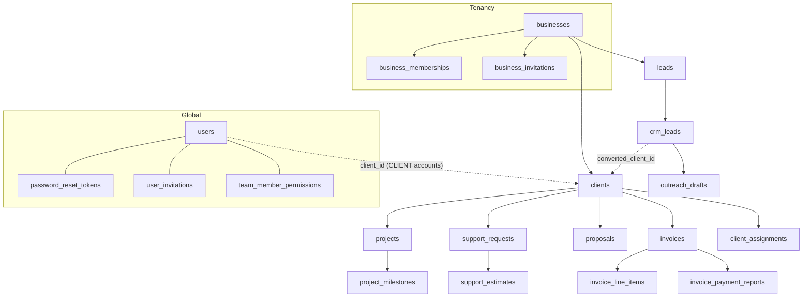

# MVP2 Independent Engineering Review (M1 + M1.1)

**Date:** 3 November 2026 · **Reviewer scope:** code, migrations, tests, CI config — read directly, not from docs.
**Boundaries kept:** no commit/push/merge/deploy; no database contacted; `.env` not used; index left as found.

## 1. Executive assessment

The M1/M1.1 business-tenancy code is careful for its stage: tenant access goes through one gate, non-members get
404, ownership changes are serialized by a row lock, invitation tokens are hashed, email-bound, expiring and single
use. The review found **no Critical issue**, one **latent High** (a test that can migrate whatever `DATABASE_URL`
points at), and several Medium consistency gaps between global roles and business roles that matter for M2.
Three small remediations were applied during the review (§3). The decisive weakness is evidential: **not one
PostgreSQL test, and none of V21–V23, has ever executed**.

**Recommendation: CONDITIONALLY READY FOR CEO APPROVAL** — to commit (in three logical commits) and push the
feature branch so GitHub Actions runs the database suites. **NOT READY for M2** until that CI run is green and an
isolated restored backup is available.

## 2. Repository and branch state

| Item | Finding |
|---|---|
| Current branch | `feature/mvp2-m1-security-hardening` (local only) |
| `feature/mvp2-m1-hardening` | **Does not exist** locally or on `origin`. The discrepancy is a naming slip in the request/docs; the real branch is `feature/mvp2-m1-security-hardening` |
| Base | `HEAD` = `67169df` (same commit as `feature/growthprint-professional-improvements`, which exists on `origin`) |
| Index | **62 files staged** (staged by the user/IDE, not by the reviewer); 0 untracked before this review |
| Review edits | 5 files now have **unstaged** changes on top of the staged versions (listed in §3) |
| vs `main` | 224 files changed incl. 8 commits already on the branch |
| Stashes | 18 entries exist (not inspected, not touched) |
| Accidental/unrelated changes | None found. No duplicate patches; no secrets in the diff |

The 62 staged files mix three generations of work and should be committed separately:
1. **Account-security contract alignment** (post-`67169df`): `AuthController`, `AccountRecoveryController`,
   `InvitationService`, `useradmin/**`, `RateLimitFilter`, account tests, `SECURITY.md`, `DECISIONS.md`,
   `DEVELOPMENT.md`, `PROJECT_STATUS.md`, `docs/api/…`.
2. **M1**: `business/**`, V21, `SecurityConfig`/`GlobalExceptionHandler`/`SecurityAudit` business parts,
   tenancy tests, `FlywayMigrationTest`, M1 docs, `ci.yml` (first rewrite).
3. **M1.1**: V22, V23, client create + lead conversion, gating flag, CI triggers/guard, M1.1 tests and docs,
   plus this review's changes.

## 3. Security findings

### Fixed during this review (unstaged changes)

| Sev | Finding | Fix | Files |
|---|---|---|---|
| High (latent) | `SeedDataCommandTest` boots the full app — **including Flyway** — against `DATABASE_URL` from the OS environment. `.env.example` instructs developers to export `DATABASE_URL`; a developer with the production URL exported would migrate (V21–V23) and seed-test production by running `mvnw test`. (It was not set on this machine, so it never happened here.) | Now also requires `GP_ALLOW_SEED_TEST=true`, and a `@BeforeAll` guard (runs before the Spring context and Flyway) refuses any `render.com` URL | `seed/SeedDataCommandTest.java` |
| Medium | **Stale invitations kept authority**: an invitation sent by an ADMIN stayed valid after that ADMIN was demoted or removed | Accepting re-checks that the inviter is still an active member allowed to grant that role; otherwise the invitation is revoked (committed via `noRollbackFor`) and 400 returned | `business/entity/BusinessInvitation.java`, `business/service/BusinessMembershipService.java`, test in `BusinessMembershipServiceTest` |
| Medium | A converted lead could be moved out of `WON` or deleted, breaking the lead→client record | Both now return 409 | `crm/lead/service/CrmLeadService.java` (**no dedicated test yet** — see §9) |

### Open findings

| Sev | ID | Finding | Recommendation |
|---|---|---|---|
| High (M2) | O1 | **Users created after V21 get no business membership.** `UserAdministrationService` (invite/accept) and `SeedDataCommand` never create a default-business membership. Harmless today (MVP1 data ignores memberships) but at M2, when data is scoped by membership, staff added after V21 would lose access | M2 backfill must re-run the membership mapping immediately before switching queries, and staff invitation must create the membership from M2 on |
| Medium | O2 | **Global and business roles drift.** Demoting a global ADMIN to TEAM_MEMBER leaves them OWNER of the default business; suspending a user leaves memberships ACTIVE (harmless: the JWT filter blocks inactive accounts; owner counts ignore them) | Decide the source of truth before M2 (recommended: business roles for business data, global role only for platform administration) |
| Medium | O3 | `BusinessAccessService.require` trusts the HTTP filter for account status; it does not check it itself. Any future non-HTTP caller (jobs) would bypass the check | Add an account-status check in the access service before background jobs exist (M5) |
| Medium | O4 | Role-matrix entries for `/businesses/**` only prove "authenticated"; membership enforcement is proven by unit tests with mocks and by PostgreSQL tests that have never run | Run CI (blocker) |
| Low | O5 | Any authenticated user can lock a business row for milliseconds (lock happens before the membership check) | Acceptable; revisit with rate limiting |
| Low | O6 | ADMIN can revoke a pending ADMIN-role invitation created by an OWNER | Optional rank check on revoke |
| Low | O7 | Members can see other members' emails (`GET /businesses/{id}/members`) | Acceptable for a team list; document in privacy notice |
| Low | O8 | `POST /clients` has no duplicate-client detection (same as MVP1) | Optional uniqueness per business in M3 |
| Low | O9 | `BusinessService.listMine` does one query per membership (N+1) | Fine at current scale |
| Info | O10 | Audit is log-only (`SECURITY_AUDIT`, `BUSINESS_ACTIVITY`); no PII, tokens or emails logged | Persistent audit in M5 |

**Verified correct:** creation gated to ACTIVE global ADMINs (flag off), CLIENT accounts never; no global-ADMIN
bypass into other businesses; role ranks, owner-only owner changes, no self-escalation; last-owner check after the
row lock and counting only ACTIVE accounts; transfer only by OWNER to an ACTIVE member; invitation token = 256-bit,
SHA-256 at rest, partial unique index, row-locked accept, expiry, email binding; conversion = lead row lock +
`isConverted` check + entity guard + V23 unique index, client and lead change in one transaction (rollback leaves
neither); conversion requires ADMIN or both `PERM_CRM` and `PERM_CLIENTS`; error responses expose no internals.

## 4. V21–V23 migration review

| Topic | Assessment |
|---|---|
| Ordering | V21 (tables + default business + mapping) → V22 (owner eligibility, default business only) → V23 (crm_leads columns). V18 unused; V19/V20 must precede. Next: **V24** |
| Fresh install | V21 creates the default business with **no members** (no users yet); V22 no-op; startup check warns "no owner". Seeded/later-created admins get no membership (O1) |
| Upgrade from MVP1 | Additive; one `UPDATE` (V22) and `ALTER TABLE crm_leads ADD COLUMN` (nullable, metadata-only) + FK + CHECK (brief ACCESS EXCLUSIVE; validation scans crm_leads where all values are NULL) |
| Default owner | Only ACTIVE global ADMINs end as OWNER; INVITED/SUSPENDED → MEMBER; DISABLED and CLIENT → none. If none ACTIVE → ownerless (documented recovery) |
| V23 and existing leads | All existing rows get NULL/NULL, satisfying the completeness CHECK; partial unique index ignores NULLs |
| Failure/recovery | Each migration is a single Flyway transaction (PostgreSQL transactional DDL): a failure rolls back that version. Recovery = fix forward with a new version; production recovery = restore the pre-deploy backup |
| **Unverified assumptions** | (1) Which version production is at — if below V17/V19/V20, V17–V23 run together for the first time; (2) production has ≥1 ACTIVE ADMIN; (3) V17's `NOT VALID` constraints hide no bad rows; (4) the V1/V11 duplicate `CREATE TABLE IF NOT EXISTS` produced the expected `clients`/`crm_leads` shape (V23's FK depends on `clients.id`) |

## 5. Test coverage and execution evidence

**Backend (executed):** `$env:JAVA_HOME=$HOME\.jdks\ms-21.0.12.1; .\mvnw.cmd clean test` →
**882 tests, 0 failures, 0 errors, 46 skipped, BUILD SUCCESS** (after the review fixes).

| Skipped suite | # | Why | Meaningful when it runs? |
|---|---|---|---|
| FlywayMigrationTest | 7 | no `GP_IT_DATABASE_URL` | Yes — every migration applied; core tables incl. V21 tables |
| InvoiceLineItemTriggerIntegrationTest | 11 | same | Yes |
| BusinessWorkflowIntegrationTest | 7 | same | Yes |
| AccountSecurityWorkflowIntegrationTest | 5 | same | Yes |
| BusinessTenancyWorkflowIntegrationTest | 3 | same | Yes — cross-business 404 + no data change, roles per business, transfer |
| PortalOnboardingWorkflowIntegrationTest | 3 | same | Yes — its endpoints now exist; contracts match by inspection (create client 201 with `legalName` default, conversion 201 then 409, lead `WON` + `convertedClientId`, invite → preview → accept, suspend/reactivate, `/auth/password` 204, user list `clientName`) |
| CrmLeadRepositoryIntegrationTest | 3 | same | Yes |
| PostgreSQLIntegrationTest | 1 | same | Smoke |
| MembershipEligibilityMigrationTest | 2 | same | Yes — runs real Flyway to V20, seeds users in every state, migrates to latest, asserts roles |
| LastOwnerConcurrencyIntegrationTest | 1 (×5 when running) | same | Partly — asserts the invariant (exactly one demotion succeeds) but cannot force both transactions to overlap; it can pass without contention |
| SeedDataCommandTest | 3 | opt-in (`DATABASE_URL` **and** `GP_ALLOW_SEED_TEST=true`) | Intentionally excluded from CI |

Tests that pass without exercising database behaviour: role-matrix business routes (mocked services),
`LeadConversionServiceTest` (unique index and rollback not exercised — covered only by the onboarding suite's
row-lock path), all `*ServiceTest` concurrency claims.

**Frontend (executed, branch `feature/premium-ui-modernization`):** `npm run lint` (tsc) exit 0;
`npm test` 111/111; `npm run build` compiled successfully.

## 6. CI readiness

| Check | Status |
|---|---|
| Triggers | push to `main`, `feature/**`, `fix/**`; PRs to `main`; manual dispatch ✔ (a PR from a feature branch runs twice — acceptable) |
| Build | `./mvnw -B clean verify`; `mvnw` is stored LF (`.gitattributes`), executable bit set by `chmod` ✔ |
| JDK / DB | Temurin 21; `postgres:16-alpine` with `pg_isready` health check; throwaway credentials in workflow env ✔ |
| Skip guard | Sums `<testsuite skipped>` across reports; allows only `SeedDataCommandTest`. Dry-run on local reports: 46 vs 3 → fails as intended ✔ |
| **Actual GitHub run** | **None.** Requires committing and pushing (CEO approval). `gh` CLI unavailable here |

## 7. PostgreSQL verification options

| Option | Available here? | Risk | Use for |
|---|---|---|---|
| Local PostgreSQL install | No (`C:\Program Files\PostgreSQL` absent, no `psql`) | Low | Dev runs |
| Disposable container | No Docker | Low | Dev runs |
| **GitHub Actions service** | Yes, after push | **Lowest**, no cost on public/free minutes | **All 43 PostgreSQL tests — recommended first step** |
| Isolated restored backup | Not provided | Low if isolated | M2 rehearsal only |
| Shared Render DB | Forbidden | — | Never |

Reproducible local commands (for an engineering machine with Docker):
```bash
docker run --rm -d --name gp-it -e POSTGRES_PASSWORD=gp_it_only -e POSTGRES_USER=gp_it -e POSTGRES_DB=gp_it -p 55432:5432 postgres:16-alpine
```
```powershell
$env:GP_IT_DATABASE_URL="jdbc:postgresql://localhost:55432/gp_it"; $env:GP_IT_DATABASE_USERNAME="gp_it"; $env:GP_IT_DATABASE_PASSWORD="gp_it_only"
$env:JAVA_HOME="$HOME\.jdks\ms-21.0.12.1"; .\mvnw.cmd clean verify
```

## 8. M2 prerequisites and blockers

1. Green GitHub Actions run with 0 non-seed skips (blocker).
2. Isolated restored backup + identity verification (blocker).
3. Production Flyway version known; ≥1 ACTIVE ADMIN; V17 constraints validated on the restore.
4. Decision on global vs business role precedence (O2).
5. Membership re-mapping step in the M2 plan (O1).

**M2 dependency map**



Composite `(business_id, …)` FKs required for: projects→clients, project_milestones→projects,
support_requests→clients, support_estimates→support_requests, proposals→clients, invoices→clients,
invoice_line_items→invoices, invoice_payment_reports→invoices, crm_leads→leads, crm_leads.converted_client_id→clients,
outreach_drafts→crm_leads, client_assignments→clients. Backfill order follows the arrows. Global-role dependencies
to replace: every `@PreAuthorize("hasAnyAuthority('ROLE_ADMIN','PERM_*')")` on module controllers and the URL rules
in `SecurityConfig`. **MVP1 behaviour at risk in M2:** staff added after V21 (O1), global ADMIN visibility of all data,
client-portal `/my` endpoints (must keep `users.client_id` scoping), invoice PDF numbering if made per-business,
public inquiries (must keep landing in the default business).

## 9. Prioritized remediation plan

1. **CEO:** approve three commits + push of `feature/mvp2-m1-security-hardening` (no merge) → first CI run.
2. Fix whatever the first CI run reveals (expected risk areas: Flyway on clean PostgreSQL, onboarding suite).
3. Add tests: converted-lead stage/delete guard (`CrmLeadServiceTest`), concurrent lead conversion (PostgreSQL),
   a forced-overlap variant of the last-owner test.
4. Decide O2; implement O3 before any background jobs.
5. Provide the isolated restored backup → M2 rehearsal (inventory, V21–V23, membership re-map, backfill, validation).

## 10. Final recommendation

**CONDITIONALLY READY FOR CEO APPROVAL** — for committing and pushing to obtain CI evidence only.
Conditions: three logical commits; no merge; CI must show all PostgreSQL suites executed and passing before any
further milestone. **M2: NOT READY** (blocked on CI evidence and the isolated restored backup).
