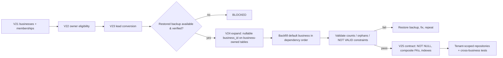

# MVP2 M1.1 — Security Hardening, CI Reliability and M2 Readiness

**Date:** 3 November 2026 · **Branch:** `feature/mvp2-m1-security-hardening` (created from
`feature/growthprint-professional-improvements`, carrying its uncommitted work) · Nothing committed, pushed,
merged or deployed. No database was contacted; `.env` was not used.

**M2 readiness: BLOCKED** — code and migrations are ready for rehearsal, but (1) no PostgreSQL test has ever executed
(locally or on GitHub) and (2) no isolated restored production backup exists. See §8.

---

## 1. Executive summary

| Workstream | Result |
|---|---|
| 1. M1 security remediation | V22 corrects owner eligibility; owner counting ignores non-active accounts; locks taken before authorization; invitation-pending bug fixed; transfer only to active accounts; business creation restricted to global ADMINs by default |
| 2. Tenant isolation design | Every table classified; every MVP1 API listed with its cross-business exposure and M2 strategy (§5) |
| 3. Client & lead workflow | `POST /api/v1/clients` and transactional, once-only `POST /api/v1/crm-leads/{id}/convert-to-client` implemented under the existing permission model; V23 adds the conversion record with a DB-level duplicate guard |
| 4. CI & tests | CI runs on feature branches/PRs/manual dispatch and **fails if any database test is skipped**; 26 new tests (unit + role matrix + 2 PostgreSQL suites) |
| 5. Migration & recovery | Executable expand → backfill → validate → contract sequence with rollback per stage (§6) |
| 6. Documentation | This report; milestone log updated |

## 2. Changed files and migration details

**Migrations (V21 untouched)**
- `V22__restrict_default_business_owner_eligibility.sql` — in the default business, OWNER memberships whose user
  account is not `ACTIVE` become `MEMBER`. Nothing deleted. If no active ADMIN exists, the default business is left
  ownerless (no owner is invented); see "Ownerless default business" in §6.
- `V23__add_crm_lead_client_conversion.sql` — `crm_leads.converted_client_id` (FK → clients, `ON DELETE RESTRICT`),
  `converted_at`, completeness CHECK, unique partial index (a client comes from at most one lead).

**Main code**
- `business/repository/BusinessMembershipRepository.java` — `countActiveWithRole` joins users and counts only
  ACTIVE accounts.
- `business/service/BusinessMembershipService.java` — business row lock **before** the actor's role is read
  (changeRole, removeMember, transferOwnership, invite); accept-as-existing-member now closes the invitation and
  keeps the role; ownership transfer requires the new owner's account to be ACTIVE.
- `business/service/BusinessService.java` — creation gated by `app.businesses.self-service-creation-enabled`
  (default `false` → global ADMIN only; CLIENT accounts never).
- `business/service/DefaultBusinessOwnerCheck.java` (new) — read-only startup warning if the default business has
  no active OWNER.
- `client/dto/CreateClientCommand.java` (new), `client/service/ClientService.java` (`create`),
  `client/controller/ClientController.java` (`POST /api/v1/clients`).
- `crm/lead/dto/ConvertLeadToClientCommand.java` (new), `crm/lead/service/LeadConversionService.java` (new),
  `crm/lead/entity/CrmLead.java` (conversion fields, `markConverted`, `carryConversionFrom`),
  `crm/lead/service/CrmLeadService.java` (pipeline update keeps conversion), `crm/lead/dto/CrmLeadResponse.java`
  (+`convertedClientId`, `convertedAt`, additive), `crm/lead/repository/CrmLeadRepository.java` (row lock),
  `crm/lead/controller/CrmLeadController.java` (endpoint).
- `src/main/resources/application.yml` — `app.businesses.self-service-creation-enabled: false`.
- `.github/workflows/ci.yml` — triggers + skip guard.

**Tests**
- `business/service/BusinessMembershipServiceTest.java` (+3: inactive-account transfer, accept-as-member,
  self-escalation), `business/service/BusinessServiceTest.java` (new, 4), `crm/lead/service/LeadConversionServiceTest.java`
  (new, 3), `security/RoleMatrixSecurityTest.java` (+2 routes, CRM-only cannot convert),
  `business/MembershipEligibilityMigrationTest.java` (new, PostgreSQL, 2), `business/LastOwnerConcurrencyIntegrationTest.java`
  (new, PostgreSQL, repeated 5×), `workflow/BusinessTenancyWorkflowIntegrationTest.java` (users are global ADMINs because
  creation is now gated).

## 3. Security findings

| ID | Finding (from M1 verification) | Status |
|---|---|---|
| R1 | Business creation open to all staff while MVP1 data is unscoped | **Resolved** — ADMIN-only by default; flag must stay off until M2/M3 |
| R2 | V21 made INVITED/SUSPENDED admins OWNER | **Resolved** by V22 (forward-only) |
| R3 | Default business may have no usable owner | **Mitigated** — no owner invented; startup warning; documented recovery; owner counts ignore inactive accounts |
| R4 | Actor role read before lock | **Resolved** — lock first, then authorize |
| R5 | Accept as existing member left invitation pending | **Resolved** |
| new | Ownership could be transferred to a suspended account | **Resolved** |
| R6 | Concurrent invites → generic 409 | Accepted (DB unique index guarantees correctness) |
| R7 | Audit is log-only | Open — M5 |
| R8 | MANAGER has no distinct permissions | Open — M3/M4 |
| — | MVP1 data still governed by global roles | Open by design until M2 |

## 4. Tests executed

Command: `$env:JAVA_HOME=$HOME\.jdks\ms-21.0.12.1; .\mvnw.cmd clean test`
**Result: 881 tests, 0 failures, 0 errors, 46 skipped. BUILD SUCCESS.**

| Skipped | Count | Reason |
|---|---|---|
| PostgreSQL-tagged suites (Flyway, invoice trigger, workflows ×5, CRM repository, PostgreSQL smoke, M1 tenancy, V22 migration, last-owner concurrency) | 43 | No `GP_IT_DATABASE_URL` locally (the repeated concurrency test counts as 1 while skipped) |
| `SeedDataCommandTest` | 3 | Opt-in by design: runs the real seed command only when `DATABASE_URL` is set; kept off in CI because `DATABASE_URL` is the application's real database variable |

## 5. CI status

| | Status |
|---|---|
| Local | Unit + MockMvc suites executed (above). CI skip-guard script dry-run against local reports: correctly reports 46 skipped vs 3 allowed → would fail |
| GitHub Actions | **Not executed.** Requires a push (CEO approval). `gh` CLI not installed. |
| Expected first run | All PostgreSQL suites run; the onboarding test's missing endpoints now exist, so its known failure cause is removed — **unverified until it runs** |

## 6. Migration sequence and recovery

| Stage | Locking risk | Integrity checks | Rollback / recovery |
|---|---|---|---|
| V21–V23 | Short; DDL on new tables + one small UPDATE + `ALTER TABLE crm_leads ADD COLUMN` (no rewrite, nullable) and a FK/CHECK on crm_leads (brief ACCESS EXCLUSIVE) | Default business present; ≥1 active OWNER; CLIENT users have no membership | Forward-only. Recovery = restore pre-deploy backup. Additive, so the old app version still runs against the new schema |
| Expand (V24) | `ADD COLUMN` nullable — metadata only | — | Drop the new columns in a follow-up migration; or restore |
| Backfill | Row updates; run in batches per table outside peak | Per table: count before = count with business_id afterwards; NULL/orphan FK counts = 0 | Columns are nullable → set back to NULL, or restore |
| Validate | `VALIDATE CONSTRAINT` takes SHARE UPDATE EXCLUSIVE (non-blocking for reads/writes) | V17 `NOT VALID` constraints validated; composite relationships consistent | Nothing changed if validation fails |
| Contract (V25) | `SET NOT NULL` scans the table (ACCESS EXCLUSIVE) — use `CHECK (business_id IS NOT NULL) NOT VALID` + `VALIDATE` first, then `SET NOT NULL` | Same counts as backfill | Restore backup (contract is the point of no easy return) |

**Ownerless default business (recovery procedure).** Symptom: startup warning from `DefaultBusinessOwnerCheck`.
Procedure (CEO-approved, reviewed SQL in a migration, never ad hoc in production): identify the intended owner (an
ACTIVE global ADMIN), then `UPDATE business_memberships SET role='OWNER' WHERE business_id='6a1e0b7c-…b001' AND user_id=:id`,
or insert the membership. Verify with the startup check.

### Table ownership classification

| Class | Tables |
|---|---|
| Global identity | `users`, `password_reset_tokens`, `user_invitations`, `team_member_permissions` |
| Platform / tenancy | `businesses`, `business_memberships`, `business_invitations`, `flyway_schema_history` |
| Business-owned (need `business_id`) | `leads`, `crm_leads`, `clients`, `projects`, `project_milestones`, `support_requests`, `support_estimates`, `proposals`, `invoices`, `invoice_line_items`, `invoice_payment_reports`, `outreach_drafts` |
| Relationship data (inherits business) | `client_assignments` (client ↔ user), `users.client_id` for CLIENT accounts |
| Platform settings, to become per-business later | `ai_settings`, `ai_usage` |

Backfill order: `clients`, `leads` → `crm_leads` → `projects` → `project_milestones`, `support_requests` →
`support_estimates`, `proposals`, `invoices` → `invoice_line_items`, `invoice_payment_reports`, `outreach_drafts`.

### MVP1 APIs with cross-business exposure (all currently global)

| Module | Endpoints | Today | M2 strategy |
|---|---|---|---|
| Leads/CRM | `/leads`, `/crm-leads/**` incl. conversion | ADMIN or PERM_CRM, all rows | Business-scoped routes resolving context through `BusinessAccessService`; repositories take `businessId` |
| Clients | `/clients/**` | ADMIN or PERM_CLIENTS, all rows | same; composite FK `(business_id, client_id)` everywhere |
| Projects, support, proposals, outreach | `/projects/**`, `/support-requests/**`, `/proposals/**`, `/outreach/**` | ADMIN or module permission, all rows | same |
| Invoices + PDFs + payment reports | `/invoices/**` | ADMIN, all rows | same; ADMIN-equivalent business role |
| Client portal | `/*/my/**` | CLIENT, scoped by `users.client_id` | Unchanged semantics; client's business derived from its client row |
| AI | `/admin/ai/**`, `/support-requests/{id}/ai/triage` | ADMIN, global settings | Per-business settings later |
| User admin | `/admin/users/**` | Global ADMIN | Becomes platform admin; business membership admin moves to `/businesses/{id}/members` |
| Public inquiry | `/public/inquiries` | Anonymous → default business | Per-business intake forms later |

Compatibility: existing routes keep working and resolve to the default business during migration; new
business-scoped routes are added alongside; old routes are retired only with an approved deprecation plan.

## 7. PostgreSQL-specific checks not executed (and why)

No PostgreSQL instance, Docker, `psql` or `gh` is available, and the production-shaped database must be an
isolated restored backup (not provided). Not executed: V21–V23 on PostgreSQL, the V22 eligibility migration test,
last-owner concurrency, all workflow suites (including onboarding and tenancy), and every restored-data check.

## 8. M2 readiness — **BLOCKED**

Ready: V22/V23 written; access, ownership and conversion logic hardened and unit-tested; classification,
API strategy and migration/rollback plan defined; CI configured to prove database tests run.
Blocking (in order):
1. A GitHub Actions run (requires approval to push) showing **0 non-seed skips and 0 failures**.
2. An isolated restored production backup with verified identity (`GP_IT_DATABASE_*` set in the environment).
3. Rehearsal results: V21–V23 on restored data, ≥1 active OWNER, ownership inventory with no ambiguous rows.

## 9. Recommended next milestone and CEO decisions

Next: **M1.2 — CI proof**, then **M2 rehearsal**.
Decisions needed:
1. Approve committing this branch and pushing it so GitHub Actions runs (no merge, no deploy).
2. Provide the isolated restored backup (and backup timestamp).
3. Confirm the default-business owner(s) if production has no active global ADMIN.
4. Confirm client creation and lead conversion stay ADMIN / module-permission based until M2 (implemented that way).
